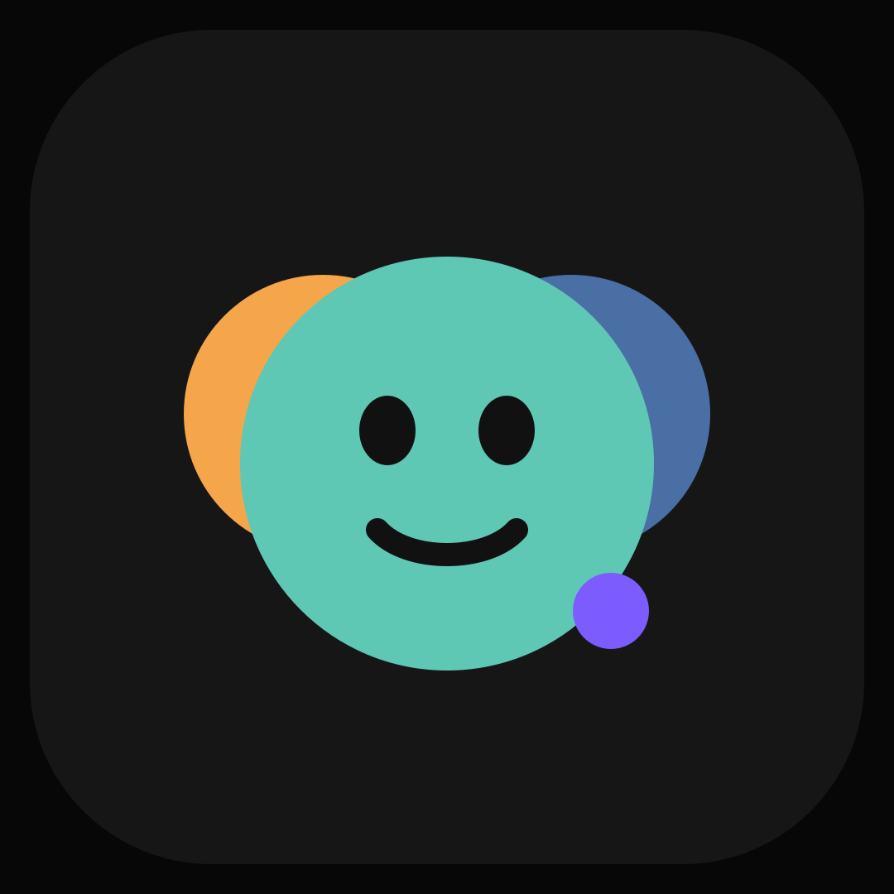
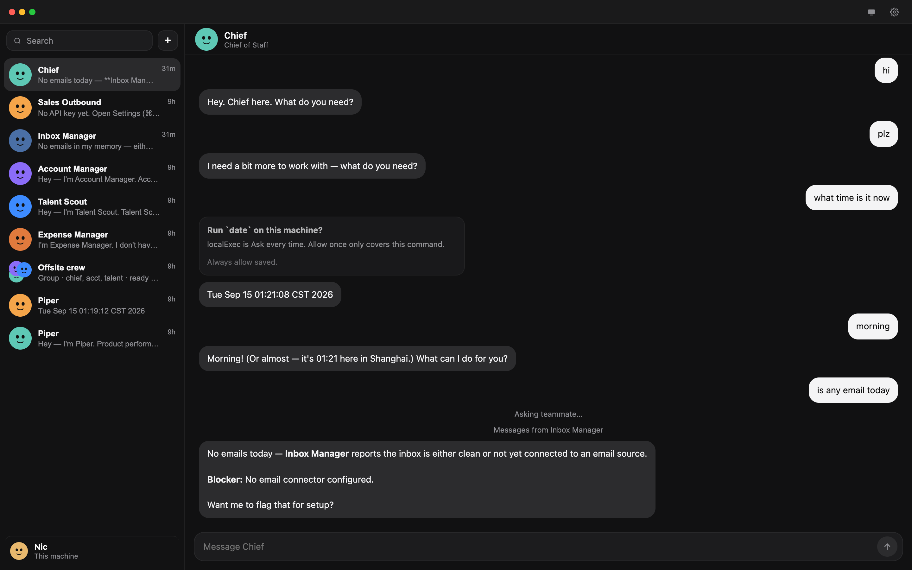
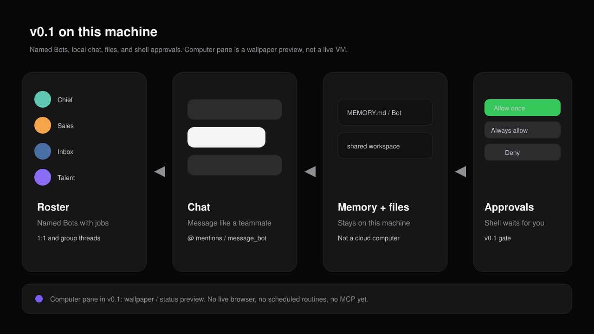

# OpenGrokBot



[English](README.md) · [中文](README.zh-CN.md)

**AI teammates that finish the work — on your machine.**

Message Bots like teammates. Give one a job, keep it around, add another when the work grows. They remember how you work, hand off to each other, and come back when something needs your approval.

OpenGrokBot is the open-source **[Grok Bot](https://x.ai/bot) alternative**. Same product shape. Same primitives. Your computer instead of theirs.



> Unofficial community project for learning. Not affiliated with xAI, Grok, or Cursor. See [Disclaimer](#disclaimer).

## How to use

You bring your own model. OpenGrokBot does not ship one. Point it at local **Ollama** (`/v1`) or any **OpenAI-compatible API** (DeepSeek, OpenRouter, MiniMax-style endpoints, and the rest).

1. Install Node 20+ and [pnpm](https://pnpm.io).
2. Clone, install, start:

```bash
git clone https://github.com/nickylin/OpenGrokBot.git
cd OpenGrokBot
pnpm install
pnpm start
```

3. Open [http://127.0.0.1:3088](http://127.0.0.1:3088).
4. Settings → Harness: pick the engine (OpenAI-compatible API, Ollama, Codex CLI, Cursor Agent, or DeepSeek Harness). If a local CLI is missing, copy the install command and install it yourself. For HTTP engines, Settings → Models: paste Base URL, API key, and model. **Ollama:** Base URL like `http://127.0.0.1:11434/v1`. If that server does not check keys, a dummy key is fine.
5. Test connection.
6. Pick a Bot in the left roster and send a message.

Keys stay on this machine in `~/.opengrokbot/settings.json`. Do not commit them. Do not put them in a Bot description or chat.

Defaults bind to `127.0.0.1:3088`. Override with `OPENGROKBOT_HOST`, `OPENGROKBOT_PORT`, or `OPENGROKBOT_HOME`. `pnpm dev` watches files. `pnpm typecheck` runs `tsc --noEmit`.

## Desktop app (macOS)

OpenGrokBot ships an unsigned Electron `.dmg` for local use. The desktop app starts the Fastify server for you and opens the UI in a window. Closing the window hides the app to the menu-bar tray; click the tray icon or use the Dock to show it again, or choose **Quit** from the tray menu to exit fully. In **Settings → Agent → Start at login**, macOS can launch the app at login in the background (menu-bar tray only until you show the window).

**Prerequisites:** macOS, Node 20+ on `PATH` (the packaged app spawns your system `node`), pnpm.

**Build a DMG:**

```bash
pnpm install
pnpm build:dmg
```

Artifacts land in `release/` (for example `release/OpenGrokBot-0.6.0.dmg`, `release/OpenGrokBot-0.6.0-mac.zip`, and `release/mac/OpenGrokBot.app`).

If `electron-builder` hangs on the DMG step, the app bundle and zip are still valid. Create a DMG manually:

```bash
hdiutil create -volname "OpenGrokBot" -srcfolder release/mac/OpenGrokBot.app -ov -format UDZO release/OpenGrokBot-0.6.0.dmg
```

**Install an unsigned build:** macOS may block the first launch. Right-click **OpenGrokBot → Open**, or run:

```bash
xattr -cr /Applications/OpenGrokBot.app
```

**Dev with Electron:**

```bash
pnpm dev:desktop
```

This runs the TypeScript dev server and opens Electron once `/api/health` responds.

**Limitations (v0.6.0):** requires Node 20+ on `PATH` (the app spawns your system `node` to run the server). No code signing or auto-update. Menu-bar tray and optional **login at startup** (macOS Login Item, background tray) are included: closing the window keeps the server running until you quit from the tray. After a full **Quit**, scheduled routines do not run until you open the app again (no separate launchd agent). CLI harnesses (`codex`, `cursor`, `dsh`) still need separate install on the machine, and MCP tools, browser tools, `skill_read`, `${secret:}` substitution, and form cards are only wired into the HTTP harnesses (OpenAI-compatible / Ollama), not the CLI ones (typing `/skill-id` still works there — the instructions ride in the prompt). Voice dictation needs a browser with the Web Speech API (Chrome); the mic button hides itself where it is unavailable. The ego lite adapter is written against Citro Labs' public JS SDK docs and has not been verified against a live ego install yet; the agent-browser adapter and the Playwright MCP preset are live-tested. User data stays in `~/.opengrokbot/` either way.

### Background notifications

When the tab or Electron window is in the background, OpenGrokBot can alert you when:

- a Bot finishes a reply
- a Bot needs approval (`Blocked`)
- a scheduled routine starts (via roster polling)

Turn this on in **Settings → Agent → Background notifications**. The browser or macOS will ask for permission the first time. Click a notification to focus the app and open that Bot. Notifications are skipped while you are actively viewing the app in the foreground.

## Same Bot. Your computer.

Official Grok Bot ([docs](https://docs.x.ai/grok-bot/overview)): named teammates with jobs and compounding context. Each one works a persistent computer — browser, filesystem, terminal — and messages you like iMessage, not like a chatbot dump.

| | Grok Bot | OpenGrokBot |
|---|---|---|
| What you talk to | Named Bots with jobs | Same |
| Sidebar | Bot roster, not chat history | Same |
| Computer | Cursor cloud VM, keeps running when the laptop sleeps | **Your machine.** Sleep stops work. That’s the trade. |
| Workspace | One `/workspace` for every Bot | One folder on disk, same sharing model |
| Model | Cursor / Grok picks | You bring any OpenAI-compatible API |
| Setup | A message, not a workflow builder | Same |
| Price | Cursor / SuperGrok plan | Free. MIT |

## What v0.6 ships

This is a working local app, not a README stub.

**New in v0.6.0** — Bots can drive a real browser, two ways, both opt-in:

- **Built-in browser via MCP presets** — Settings → Browser adds Microsoft's Playwright MCP (its own profile folder, Chrome-for-Testing build — no system Chrome needed; the one-time browser download runs when you add it) or Google's Chrome DevTools MCP in one click. Bots drive them through the existing `mcp_` tools.
- **Linked browser apps** — if you already run a browser agent CLI, link it (off by default, only ever enabled by you in Settings → Browser): the open-source **agent-browser** (Apache-2.0, Vercel Labs) or **ego lite** (Citro Labs; great logged-in Spaces, but the browser itself is closed-source — the consent text says so before you link). Bots get native `browser_open / browser_snapshot / browser_click / browser_fill / browser_screenshot` tools, gated by the same Ask / Auto / Allow-all modes as shell commands, and screenshots show up live in the Computer pane.

v0.5.0 added the Skills library, memory import, and voice dictation; v0.4.0 added MCP connectors, `${secret:}` substitution with output masking, and routine webhooks; v0.3.0 added form cards + write-only secrets; v0.2 added the desktop app. Full history: [CHANGELOG.md](CHANGELOG.md).

**In this release**

- **macOS desktop app** — unsigned Electron `.dmg`; spawns the local server, menu-bar tray, close-to-tray (quit from tray menu), optional start at login (background tray)
- Named roster plus Create a Bot (color, shape, expression)
- **Harness switcher** — OpenAI-compatible HTTP, Ollama, Codex CLI, Cursor Agent, or DeepSeek Harness, with install hints for missing local CLIs
- **Avatars** — 8 shapes and 8 expressions; lifecycle motion (idle / thinking / working / waiting / blocked / done) on the face, not a separate spinner
- **Token streaming** — OpenAI-compatible harness streams reply text into the bubble as tokens arrive (CLI harnesses still return full replies)
- 1:1 and group threads; group messages route through a coordinator Bot and mirror member replies into the thread
- `@` mentions (clickable in chat) and `message_bot` handoffs shown as system strips, not user bubbles
- **Markdown in bubbles** — tables, horizontal rules, headings, lists, bold, inline code, fenced blocks, links
- Per-Bot markdown memory and a shared workspace on disk
- Shell commands behind Allow once / Always allow / Deny; **Allow resumes the agent loop** with command output
- **Interactive form cards** — a Bot can call `request_form` to ask for structured input (text, number, date, select, multi-select, switch) in one card instead of question-by-question chat; submitting resumes the paused turn with clean typed values
- **Secret fields that never reach the model** — a form field of type `secret` is stored straight into `~/.opengrokbot/secrets.json` (mode 0600); the transcript and the model only ever see a masked reference (`provided` / `ref` / `last4`). `GET /api/secrets` lists masked statuses, `DELETE /api/secrets/:name` removes one — no route returns a value
- **MCP connectors** — stdio MCP servers from `~/.opengrokbot/mcp.json` (managed in Settings → Connectors) expose their tools to every Bot as `mcp_<server>_<tool>`; server env values may reference vault secrets as `${secret:name}`, substituted at spawn time
- **`${secret:name}` in shell commands** — substituted locally at execution time (the approval card shows the placeholder, never the value); all tool results pass an output masker that scrubs any echoed secret value before the model or transcript sees it
- **`/routine` picker** — type `/` in the composer to fire a Bot's routine prompt
- **Scheduled routines** — in-process scheduler fires enabled routines while the app is open (Settings → Agent → Host scheduler)
- **Webhook routine triggers** — `POST /api/hooks/routines/<botId>/<routineId>` with the routine's `x-webhook-token` header fires it now; `{ "text": "…" }` is appended to the prompt. Runs from every trigger are kept in `~/.opengrokbot/routine-runs.json` (last 20 per routine, shown in Settings → Agent)
- **Skills library** — markdown skills in `~/.opengrokbot/skills/` (Settings → Skills), shared by all Bots; `/` picker lists routines and skills together. Bots see skill descriptions in their system prompt and can load one mid-task with the `skill_read` tool; typing `/<skill-id> task` preloads it as the turn's instructions
- **Memory import** — Settings → Agent: paste another assistant's memory export into any Bot's `MEMORY.md`, deduplicated line-by-line against what it already knows (`POST /api/bots/:id/memory/import`)
- **Voice dictation** — mic button in the composer where the Web Speech API exists (Chrome); speech lands in the input box for review before sending, never auto-sent
- **Browser control** — Settings → Browser: one-click MCP presets (Playwright MCP with its own `~/.opengrokbot/browser-profile`, Chrome DevTools MCP) plus optional linking of a local agent-browser or ego lite install. Linked browsers expose native `browser_*` tools behind the localExec approval gate; their screenshots render in the Computer pane (`~/.opengrokbot/browser/last-screenshot.png`)
- **Background notifications** — browser or macOS alerts when a reply finishes, approval is needed, or a routine starts
- Settings → Agent: clear roster or reset to the starter bots in `data/bots/`
- Computer pane as a status preview (purple icon while active, time-of-day wallpaper), not a live VM

**Not yet**

- Vision/coordinate computer-use and a live video view of the browser (today: accessibility snapshots + still screenshots)
- General desktop computer-use beyond the browser
- Background scheduler after full Quit (login starts the app; routines still need the app process running)
- MCP over HTTP/SSE transports and MCP for CLI harnesses (stdio + HTTP harnesses only today)
- Chat attachments
- Teach-a-task recording (skills are hand-written markdown today)
- Auto-review model
- Work while the laptop sleeps

The rest of the official list below is the north star, not a claim that every item is wired today.



## UI and presence

The roster is the product, presence lives on the avatar, and the interface should ask less of you over time.

### Harness (how a turn runs)

Settings → **Harness** picks the engine for every Bot turn:

| Engine | What it uses |
|---|---|
| OpenAI-compatible | Your Base URL + API key + model (DeepSeek, OpenRouter, vLLM, etc.) |
| Ollama | Local `/v1` endpoint |
| Codex CLI | `codex` on this machine |
| Cursor Agent | `cursor` CLI / agent on this machine |
| DeepSeek Harness | `dsh` on this machine |

If a CLI harness is selected but not installed, Settings shows a copy-paste install command. HTTP engines still configure models under Settings → **Models**.

### Avatars

Create Bot → pick **Color**, **Shape**, and **Expression**.

**Shapes:** circle, oval, squircle, pill, triangle, hexagon, cloud, teardrop — flat silhouettes with diagonal-line eyes in the shape picker, closer to the official set.

**Expressions:** smile, calm, grin, sleepy, wink, wide, glasses, dots.

**Lifecycle motion** (roster + typing row): idle is calm; thinking/working/waiting/blocked change eye style and motion; done settles then returns to idle. Hover a roster row to see the Bot’s current action without extra chrome.

### Chat and threads

- Bot replies render **Markdown** — including `---` rules and `| tables |`.
- **Group chats** (2–6 Bots): your message goes to a router Bot (e.g. Chief); member replies appear in the same thread with name + avatar.
- **Handoffs** (`[Handoff from …]`) render as a centered system strip, not a user bubble.
- Click an **`@Bot`** chip in a thread to jump to that Bot’s chat.

### Roster actions

- **+** menu: New Bot, New conversation, New group.
- **Settings → Agent → Roster:** clear all bots (and transcripts) or reset to the seed YAML in `data/bots/`.

## Where this is going (the official list)

**Message Bots like teammates.** Create a Bot, describe the job in a sentence, start talking. Chief of Staff, Sales Outbound, Inbox, Account Manager, Talent Scout — focused Bots beat a General Helper.

**Work with many Bots at once.** They run in parallel. Put 2–6 in a group thread and they pass work with `message_bot`. You are not the router.

**Come back when approval is needed.** Outbound, publish, pay, shell: Allow once / Always allow / Deny. A yes covers that action, not the past.

**Context compounds.** Each Bot keeps its own memory, thread, and routines. Files, cookies, and logins sit on the shared computer so handoffs don’t mean re-login.

**Show a Bot how it’s done.** Walk it through once, save a Skill, pin a Routine on that Bot. The schedule belongs to the teammate, not to a random cron tab.

**The computer has three levels.** Purple status by default. Pin a preview of its screen. Take over only for password / 2FA / CAPTCHA, then hand it back. You never type secrets into chat.

**Connectors first, computer-use when you must.** MCP and APIs where they exist; the local browser profile when they don’t. All Bots share that profile — one user, one browser — matching official isolation (between users, not between Bots).

## A good first handoff

Same prompt the official docs start with:

> Pull this week’s pipeline review list. Skip anyone already in an active sequence. Research the top five accounts, draft outreach in my voice, and leave me drafts to approve by tomorrow morning.

Tell it what to do, where to work, what finished looks like. Correct it. Turn the stable path into a routine and pin it on that Bot.

## The one thing we will not copy

Official Bots keep working when your laptop is closed. That needs their cloud computer.

OpenGrokBot runs on the host OS. Close the lid, the team stops. In exchange: no paid seat at all — the official Bot now rides along with paid plans (X Premium, from $30/month), while this one stays free and MIT — no logins sitting in someone else’s VM, no waiting on a Bot API that does not exist.

If you need 24/7, keep a small machine awake — or stay on official Grok Bot.

## Data on this machine

| Path | What |
|---|---|
| `~/.opengrokbot/settings.json` | API key, models, paths |
| `~/.opengrokbot/secrets.json` | Secrets collected via form cards (mode 0600, write-only from the API) |
| `~/.opengrokbot/mcp.json` | MCP server declarations (command, args, env — env may use `${secret:name}`) |
| `~/.opengrokbot/routine-runs.json` | Routine run history (last 20 per routine) |
| `~/.opengrokbot/skills/` | Skills library — one markdown file per skill, YAML frontmatter |
| `~/.opengrokbot/browser-profile/` | Playwright MCP preset's own browser profile (never your everyday browser) |
| `~/.opengrokbot/browser/` | Linked-browser artifacts: last screenshot, generated ego action scripts |
| `~/.opengrokbot/bots/` | Roster YAML (seeded from `data/bots/` on first run) |
| `~/.opengrokbot/transcripts/` | Chat history |
| `~/.opengrokbot/memory/` | Per-Bot `MEMORY.md` |
| `~/.opengrokbot/workspace/` | Shared files the Bots can read and write |

License: [MIT](LICENSE).

## Disclaimer

OpenGrokBot is an independent, unofficial **open-source learning project**. It is not a product of xAI, Grok, or Cursor, and it is not endorsed, sponsored, or certified by them.

**Grok**, **Grok Bot**, **xAI**, and **Cursor** are trademarks or product names of their respective owners. We use those names only to describe what this project studies and how it differs. We do not claim any right in those marks, and **we are not the same company**.

This repository does not provide access to official Grok Bot, Cursor accounts, or xAI cloud computers. Anything you run here is on your own hardware, with keys you bring, at your own risk.
